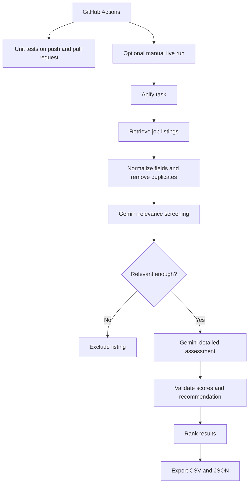

# LinkedIn Job Filter

**A Python pipeline that turns a batch of job listings into a ranked, explainable shortlist.**

The workflow collects listings with Apify, screens them against a job-search profile with Google Gemini, performs a structured assessment of relevant roles, and exports the results to CSV and JSON. It is designed to make job-search review more consistent and to keep the reasoning behind each recommendation visible.

[Workflow overview](docs/workflow.md) · [Example CSV](examples/sample_results.csv) · [Example JSON](examples/sample_results.json) · [Tests](tests/test_app.py)

## At a glance

- **Collect:** retrieve job listings from a configured Apify task.
- **Screen:** use Gemini to filter out roles that are clearly unrelated to the selected profile.
- **Assess:** score retained listings on role fit, compensation likelihood, AI relevance, and work sustainability.
- **Explain:** capture evidence, inferences, unknowns, strengths, and risks alongside an `APPLY`, `CONSIDER`, or `SKIP` recommendation.
- **Export:** save ranked results as `results/job_results.csv` and `results/job_results.json`.

## How it works



See [the workflow guide](docs/workflow.md) for the processing stages, ranking rules, and interpretation notes.

## Example output

The repository includes [a sample CSV](examples/sample_results.csv) and [a sample JSON file](examples/sample_results.json) with **fictional demonstration data**. They illustrate the output structure and are not live job listings or real model assessments.

Each detailed assessment includes four integer scores from 1 to 5:

| Field | What it represents |
| --- | --- |
| `fit_score` | Match between the role and the profile's skills and experience |
| `income_score` | Estimated likelihood that compensation meets the profile's target; not a salary amount |
| `ai_score` | Relevance of AI, machine learning, LLMs, agents, or automation |
| `low_stress_score` | Estimated work sustainability; a higher score means lower perceived risk of pressure, on-call work, or repetitive ticket handling |

Results are sorted by `fit_score`, then `income_score`, `ai_score`, and `low_stress_score`, all descending. This is a **hierarchical ranking**, not a combined score. A retained listing can still receive a detailed `SKIP` recommendation.

## Technology

- **Python** — data normalization, workflow orchestration, validation, and exports
- **Apify** — job-listing collection
- **Google Gemini API** — relevance screening and structured assessments
- **GitHub Actions** — automated unit tests and an optional manually triggered live run
- **CSV and JSON** — portable output formats

## Run tests

Tests use mocked API responses and do not require credentials or incur external API costs.

```bash
python -m pip install -r requirements.txt
python -m unittest discover -s tests -v
```

## Configuration and usage

### Required environment variables

For a live run, configure:

- `APIFY_API_TOKEN` — Apify API token
- `APIFY_TASK_ID` — ID of the Apify task to run
- `GEMINI_API_KEY` — Google Gemini API key

Optional:

- `GEMINI_MODEL` — Gemini model override; defaults to `gemini-3.5-flash-lite`

Create a local `job_search_profile.md` with your own criteria. If it exists, the program uses it; otherwise, it falls back to `job_search_profile.example.md`. Do not commit personal job-search criteria or API credentials.

### GitHub Actions

In **Settings → Secrets and variables → Actions**, add these repository secrets:

- `APIFY_API_TOKEN`
- `GEMINI_API_KEY`

Add `APIFY_TASK_ID` as a repository variable (it is configuration, not a credential). You may also add `GEMINI_MODEL` as a variable to override the default model.

On pushes and pull requests, GitHub Actions runs the mocked unit tests only. To run the live pipeline, open **Actions → LinkedIn Job Filter → Run workflow**. A manual run starts the Apify + Gemini pipeline automatically after the tests pass; it requires the secrets and variable above and may consume API credits. Results are uploaded as the `linkedin-job-filter-results` artifact and retained for 14 days.

The public workflow uses `job_search_profile.example.md`, not a private profile. To use personal criteria in automation, use a private repository with your private `job_search_profile.md` or configure a secure private-profile delivery mechanism. Never commit personal criteria to this public repository.

## Limitations and responsible use

- Model-generated scores and recommendations are decision-support signals, not objective measurements or guarantees.
- The income score estimates the likelihood of meeting a compensation target; it does not provide or guarantee a salary.
- Conclusions depend on the listing's available information and the selected profile. Missing details are recorded as unknowns where identified by the model.
- Review the original job advertisement before making application decisions.
- Live API calls can consume credits and depend on the availability and behavior of external services.

## Privacy

This is a public repository, so tracked files and commit history are visible to everyone. Keep API credentials, personal profiles, and real job-search results out of tracked files. The `.gitignore` excludes local results and the personal profile file.

## License

Released under the [MIT License](LICENSE).
