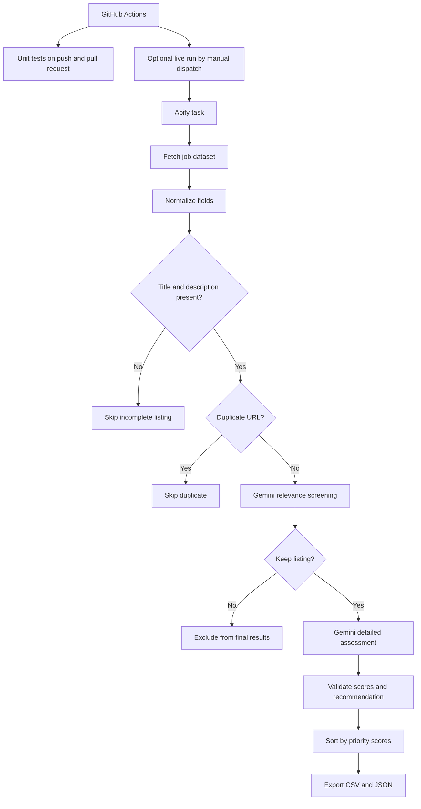

# Workflow overview

This guide documents the pipeline implemented in [`app.py`](../app.py).

## Processing stages

1. **Collect:** start the configured Apify task, wait for completion, and retrieve its dataset.
2. **Normalize and validate:** map source fields to a consistent schema; skip listings without a title or description and deduplicate listings by URL.
3. **Screen:** ask Gemini whether each remaining listing is relevant to the selected profile. Listings rejected at this stage are not included in the final exports.
4. **Assess:** for retained listings, Gemini assigns four integer scores from 1 to 5 and provides an assessment, evidence, inferences, unknowns, strengths, risks, and a recommendation (`APPLY`, `CONSIDER`, or `SKIP`).
5. **Rank and export:** sort by fit, income, AI relevance, and work sustainability, in that order, and write `results/job_results.csv` and `results/job_results.json`.

## Automation and costs

GitHub Actions runs mocked unit tests on pushes and pull requests. The external Apify + Gemini workflow runs when you manually start **LinkedIn Job Filter** from the Actions tab, after the unit tests pass. Every manual run starts the live pipeline automatically; it requires the configured credentials and can consume API credits.

## Important interpretation notes

- Scores are model-generated decision support, not objective measurements or guarantees.
- `income_score` estimates the likelihood of meeting the profile's compensation target; it is not a salary figure.
- `low_stress_score` is higher when the model estimates lower risk of pressure, on-call work, and repetitive ticket handling.
- The final ordering is hierarchical, not a composite score: `fit_score`, `income_score`, `ai_score`, and `low_stress_score`, in descending order.
- A listing that passes the initial screening can still receive a detailed `SKIP` recommendation.
- The model's conclusions depend on the profile and information in the listing. Check the original job advertisement before acting on a recommendation.
